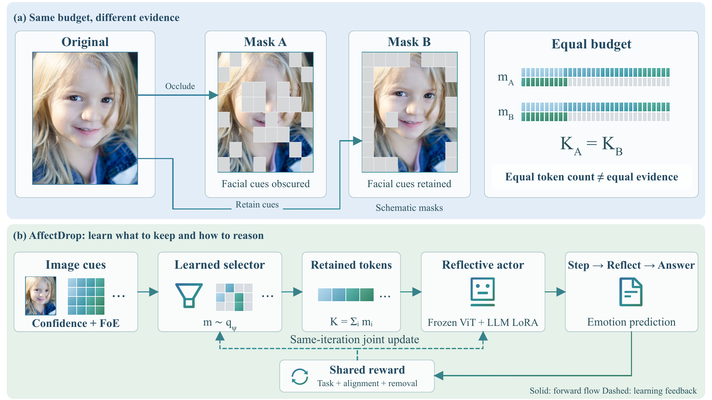
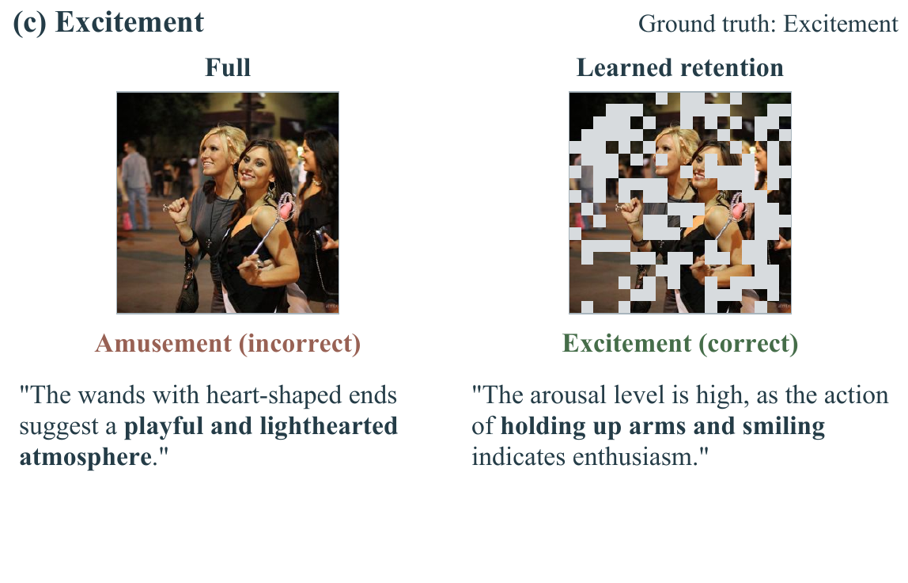
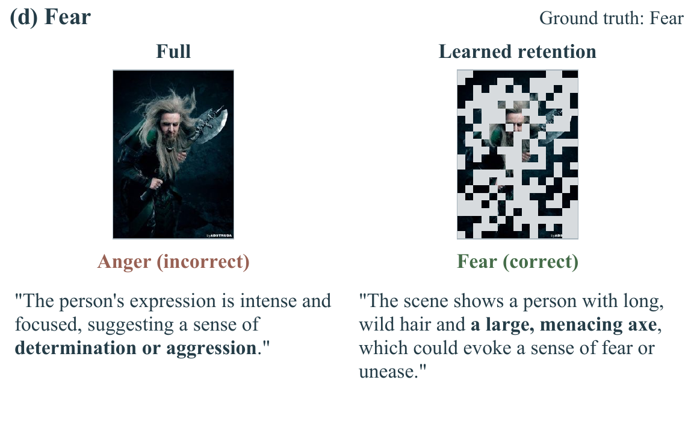

# AffectDrop

### Joint Visual Token Selection and Reflective Reasoning for Visual Emotion Understanding

**Learning what to retain, and how to reason about emotion.**

[Overview](#overview) &nbsp; | &nbsp; [Framework](#framework) &nbsp; | &nbsp; [Reasoning Examples](#reasoning-examples) &nbsp; | &nbsp; [Key Findings](#key-findings)

---

## Overview

An emotional judgment depends not only on how a model reasons, but also on the visual evidence it receives. Redundant content can distract from meaningful cues, while indiscriminate token removal can discard the expressions and context needed to distinguish related emotions.

**AffectDrop learns visual token selection together with reflective emotional reasoning.** Rather than treating token removal as a fixed preprocessing rule, it connects the choice of retained evidence to the quality of the resulting response.

  

*Equal token counts do not imply equal emotional evidence. The illustration contrasts different retained cues and shows how selection and reasoning interact through shared task feedback. Masks in this overview are schematic.*

## Framework

| Component | Role |
| :--- | :--- |
| **Random TokenDrop cold start** | Prepares the reasoning actor to interpret incomplete visual evidence. |
| **Confidence-guided visual selection** | Combines image features with emotion-oriented attention to learn which groups to retain and how much evidence to provide. |
| **Joint reflective learning** | Uses feedback from the generated response to adapt the selector and reasoner together. |

The selected groups form the visual input used for reasoning. This makes the input-selection stage inspectable while allowing the model to adapt to the evidence it retains.

## Reasoning Examples

The following paired examples are reproduced from the paper. Each contrasts a full-input response with a learned-retention response from the same actor. Gray cells mark dropped visual groups; the text is excerpted from the recorded model outputs.

### From playful appearance to excitement

  

The full-input response focuses on a playful atmosphere. With learned retention, the response instead connects gestures and smiles to high arousal, shifting the prediction from amusement to excitement.

### From the depicted person's attitude to evoked fear

  

The full-input response interprets the person's appearance in terms of determination or aggression. The learned-retention response emphasizes the threatening object and the fear it could evoke in an observer.

*These selected cases illustrate changes in the focus of emotional reasoning; they are not estimates of how frequently such changes occur. Gray masks visualize removal, rather than gray pixels supplied to the model.*

## Key Findings

- **Learning where to look matters.** With the actor and per-image retained count fixed, learned retention outperforms random and attention-ranked selection in the reported evaluation. The advantage is therefore not explained by the retained count alone.
- **Selection and reasoning benefit from adapting together.** Joint updating performs better than the tested actor-only and selector-only training variants.
- **The benefit extends beyond the training dataset.** The EmoSet-trained models retain an advantage over the reproduced EMO-R3 baseline on Emotion6 and WebEmo without target-dataset fine-tuning.
- **Correctness and perceived support are complementary.** Human evaluation gives learned retention higher mean cue-support ratings, while showing that classification accuracy and perceived support need not rank all input conditions in the same order.

Together, these observations support treating visual selection as a learned part of emotional reasoning, rather than a separate redundancy-removal step. The paper provides the quantitative comparisons and experimental conditions; this page focuses on the method and qualitative examples.

## Release Scope

This README is a visual overview, not a complete reproduction guide. Model checkpoints, dataset files, and teacher-generated training traces are not included in this release. The figures above are illustrations from the paper, not a downloadable evaluation dataset.

## Acknowledgments

The base reflective reward implementation and Structured Emotional Thinking (SET) prompt are adapted from [EMO-R3](https://github.com/SeerRay-Lab/emo-r3). See [LICENSE-EMO-R3](LICENSE-EMO-R3) for the upstream license. AffectDrop combines this base reward with attention matching and token-removal feedback to train visual selection jointly with the reasoning actor.
